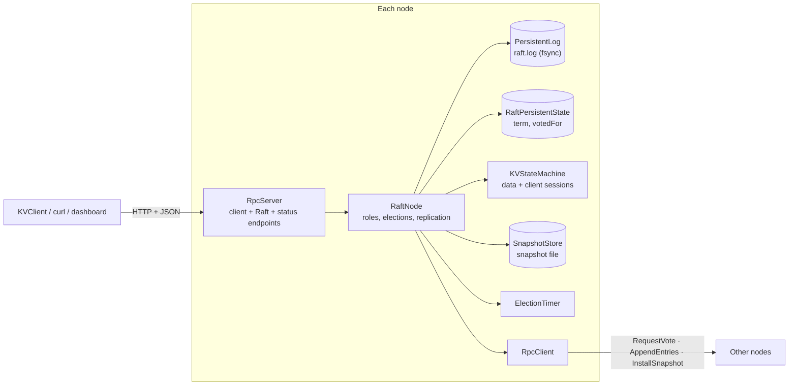
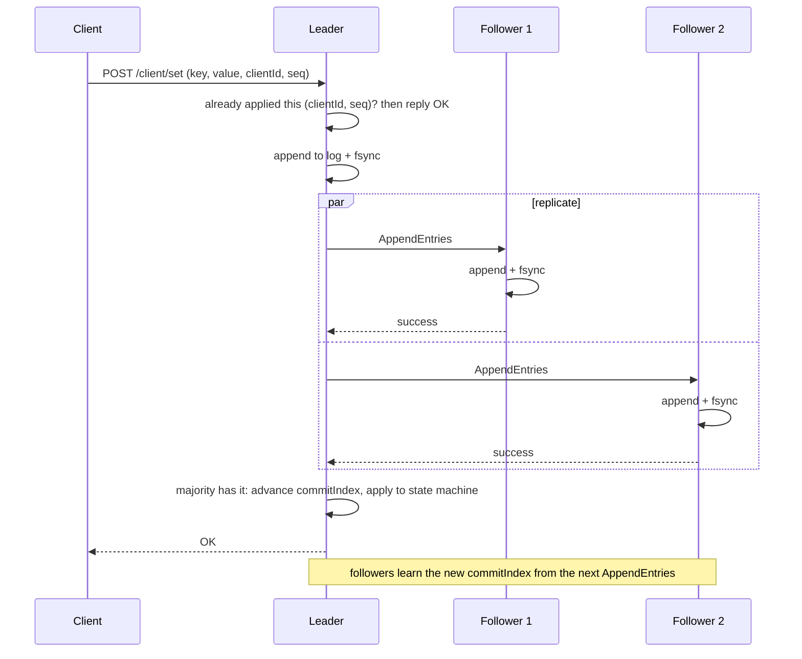

# raftkv: a fault-tolerant key-value store built on Raft

A replicated key-value store written from scratch in Java 25 with no runtime dependencies. A cluster of nodes
agrees on every write through the [Raft consensus algorithm](https://raft.github.io/raft.pdf), keeps serving
while a minority of nodes fail, and never loses an acknowledged write.

It includes a live web dashboard (every node serves one), a CLI/Java client, a benchmark tool, and a test suite
(unit, fuzz, partition scenarios and a randomized chaos test) that checks Raft's safety guarantees under faults.

Background reading: the author's notes on consensus and Raft are in [`../README.md`](../README.md). A longer write-up
of the design, the 24 bugs found along the way and the measurements is in the
[technical report](docs/REPORT.md) ([PDF](docs/REPORT.pdf)).

## Quick start

### With Docker

```bash
docker compose up --build
```

Then open the dashboard (any node serves it):

> http://localhost:8001/dashboard?nodes=localhost:8001,localhost:8002,localhost:8003

Try the cluster from the dashboard's "Read and write data" box, kill the leader with `docker compose stop node1`
and watch a new one get elected, then `docker compose start node1` to see it catch up.

### Without Docker

Requires JDK 25 and Maven.

```bash
mvn -DskipTests package
```

Start three nodes (one terminal each):

```bash
java -jar target/raftkv-jar-with-dependencies.jar --id=1 --port=8001 --peers=2:localhost:8002,3:localhost:8003
java -jar target/raftkv-jar-with-dependencies.jar --id=2 --port=8002 --peers=1:localhost:8001,3:localhost:8003
java -jar target/raftkv-jar-with-dependencies.jar --id=3 --port=8003 --peers=1:localhost:8001,2:localhost:8002
```

Use the command-line client (it finds the leader and follows redirects):

```bash
kv() { java -cp target/raftkv-jar-with-dependencies.jar io.github.parvgurung.client.KVClient --nodes=localhost:8001,localhost:8002,localhost:8003 "$@"; }
kv set greeting hello
kv get greeting
kv delete greeting
```

Or talk HTTP directly (writes must be JSON `POST`s):

```bash
curl -X POST localhost:8001/client/set -H 'Content-Type: application/json' -d '{"key":"greeting","value":"hello"}'
curl 'localhost:8001/client/get?key=greeting'
```

A node that is not the leader answers `{"success":false,"error":"not leader","leaderHint":"localhost:8002"}`.

## Architecture



### The write path



Reads go through the leader too. Before answering, the leader checks it has committed an entry from its own term
(a no-op it appends on election) and confirms with a heartbeat round that a majority still follows it, so a
deposed or partitioned leader can never return stale data.

## What is implemented

| Area | What it does | Raft reference |
|---|---|---|
| Leader election | Randomized 800-1500 ms timeouts, one vote per term persisted before replying, up-to-date-log check | paper 5.2, 5.4.1 |
| PreVote | A node asks "would you vote for me?" before bumping its term, so a cut-off or rejoining node cannot depose a healthy leader | thesis 9.6 |
| CheckQuorum | A leader that has not heard from a majority for 1.5 s steps down, so clients are redirected quickly | thesis, chapters 6 and 9 |
| Log replication | Heartbeats every 100 ms, one `AppendEntries` in flight per follower so writes batch, conflict-term backoff to repair divergent logs, chunked catch-up (at most 256 entries or about 4 MB per request), leader only commits entries from its own term | paper 5.3, 5.4.2 |
| Durability | Append-only log with group commit (concurrent writes share an fsync; the leader counts its own copy toward a majority only once it is on disk), torn-write recovery after a crash, atomic (write-fsync-rename) term/vote and snapshot files | paper 5 (persistent state) |
| Snapshots | After N applied entries (`--snapshotThreshold`, default 1000) the state is snapshotted and the log compacted; `InstallSnapshot` brings lagging or new nodes up to date | paper 7 |
| Exactly-once writes | Each client write carries a client ID and sequence number; replicas drop retries they already applied, and the dedup table is part of snapshots | paper 8 |
| Linearizable reads | Leader no-op plus a heartbeat quorum before every read | paper 8 |
| Dashboard | Per-node role, term, log/commit/snapshot bars on a shared axis, event feed, data console, simulated demo mode | |
| Safety rails | One node per data directory (file lock), JSON-only Raft RPCs (a web page cannot forge them), request size limits, strict input validation | |

## Configuration

| Flag | Meaning | Default |
|---|---|---|
| `--id` | This node's id (positive integer, unique in the cluster) | required |
| `--port` | HTTP port to listen on (1024-65535) | required |
| `--peers` | The other nodes: `id:host:port,id:host:port` | none (single-node cluster) |
| `--dataDir` | Where the log, term/vote and snapshot are stored | `./data/node<id>` |
| `--snapshotThreshold` | Applied entries between snapshots; `0` turns snapshots off | `1000` |
| `--allowOrigin` | Web origins (comma separated, or `*`) allowed to call the client endpoints from a browser. Nodes already trust their peers' origins. | none |

## HTTP API

| Endpoint | Purpose |
|---|---|
| `POST /client/set` | `{"key","value"}` plus optional `"clientId"` and `"seq"` (both or neither) for retry-safe writes |
| `POST /client/delete` | `{"key"}`, optionally with `clientId`/`seq` |
| `GET /client/get?key=` | Read a key (leader only; `value` is `null` when absent) |
| `GET /status` | One-line text summary of the node |
| `GET /status.json` | Role, term, leader, log/commit/snapshot indexes, peers (what the dashboard polls) |
| `GET /dashboard` | The web dashboard (`?demo` for a simulated cluster, `?nodes=a:1,b:2` to choose nodes) |
| `POST /raft/requestVote`, `/raft/appendEntries`, `/raft/installSnapshot` | Node-to-node RPCs (JSON POST only) |

Writes that fail with a timeout or "leadership changed" have an unknown outcome: they may still commit later.
Retry them with the same `clientId` and `seq` (the bundled `KVClient` does this for you) and the cluster applies
them at most once.

## Performance

Measured with the bundled benchmark on an Apple M5 laptop (10 cores, JDK 25.0.3): a 3-node cluster and the load
generator all in one JVM, real HTTP over loopback, 100-byte values, and an fsync before any entry counts as stored.

| Workload (16 client threads) | Throughput | p50 | p95 | p99 | max |
|---|---|---|---|---|---|
| Writes | 618 ops/s | 24.7 ms | 39.7 ms | 52.0 ms | 74.0 ms |
| Reads (linearizable) | 4,652 ops/s | 3.4 ms | 4.0 ms | 5.7 ms | 23.5 ms |

Write throughput as the number of concurrent clients grows:

| Clients | 1 | 4 | 16 | 64 | 128 |
|---|---|---|---|---|---|
| Writes/s | 95 | 225 | 634 | 1,097 | 1,194 |
| p50 latency | 11 ms | 18 ms | 24 ms | 57 ms | 106 ms |

| Failover (leader killed, 10 trials) | median | p95 | max |
|---|---|---|---|
| New leader elected | 914 ms | 1324 ms | 1324 ms |
| First client write accepted again | 919 ms | 1321 ms | 1321 ms |

A follower that missed 5,000 writes catches up in roughly 0.1 to 0.2 seconds, whether it replays the log or
receives a snapshot.

How to read these numbers:

- **Writes are bound by fsync.** One fsync costs about 3.7 ms on this machine. A single client sees about 11 ms per
  write (a flush on the leader, then one on a follower). More clients help because writes share fsyncs: concurrent
  writes on the leader are flushed together (group commit), and each follower has one `AppendEntries` in flight at a
  time so queued writes go out as a batch. With 16 clients the nodes do roughly 0.1 to 0.3 fsyncs per write. Before
  group commit the same 16-client run managed 190 writes/s at 84.5 ms p50.
- **Reads are fast** because they only cost a heartbeat round, no disk writes.
- **Failover time is dominated by the election timeout**, which is randomized between 800 and 1500 ms. Lower it for
  faster failover at the cost of more spurious elections on a slow network.
- This is one machine, one JVM and loopback networking, so treat it as a relative guide, not a production sizing.

Reproduce (the local mode starts its own cluster, kills leaders and restarts nodes):

```bash
mvn -DskipTests package
java -cp target/raftkv-jar-with-dependencies.jar io.github.parvgurung.bench.Benchmark local
```

Against a cluster you started yourself (for example with `docker compose up`), read and write workloads only:

```bash
java -cp target/raftkv-jar-with-dependencies.jar io.github.parvgurung.bench.Benchmark remote --nodes=localhost:8001,localhost:8002,localhost:8003
```

Options: `--clients`, `--seconds`, `--valueBytes`, `--failovers`, `--catchUpEntries`, `--snapshotThreshold`.

## Testing

```bash
mvn test
```

The suite (about 290 tests, a few minutes) is built around the guarantees rather than the code:

- **Unit and model tests** for the log, snapshots, state machine, JSON codec and config parsing, including a
  model-based test of the log against a trivially correct list, and a test that cuts the log file at every byte
  offset to check crash recovery.
- **Fuzz tests** feeding random and mutated data to the JSON parser, command serializer and log parser.
- **Protocol robustness tests** that send malformed, hostile and cross-site requests to every endpoint.
- **Scenario tests** with injected network partitions, crashes and restarts: writes taken by a cut-off leader are
  never committed, a minority cannot commit, stale leaders never serve reads, retries are deduplicated across
  failover, and clusters of 1, 2, 4, 6 and 7 nodes behave.
- **A randomized chaos test** (`ChaosTest`) that partitions, crashes and restarts nodes while clients write and
  read, then checks that there was never more than one leader per term, no acknowledged write was lost, no read
  returned a wrong value, and every replica converged. Run it longer or with other seeds:

  ```bash
  mvn test -Dtest=ChaosTest -Dchaos.seconds=60 -Dchaos.seedOffset=1000
  ```

Deliberately breaking the voting rule makes the chaos test fail, so it can detect real safety bugs.

## Project layout

```
src/main/java/io/github/parvgurung/
  node/        RaftNode (the algorithm), ElectionTimer, NodeRole
  rpc/         RpcServer / RpcClient and the request and response types
  log/         PersistentLog (append-only file, base offset after compaction)
  snapshot/    Snapshot and SnapshotStore
  state/       RaftPersistentState (term and vote)
  statemachine/ KVStateMachine, Command (with client sessions)
  client/      KVClient (library and CLI)
  bench/       Benchmark
  config/      NodeConfig (command-line flags)
  util/        Json (hand-written codec), FileUtil (atomic writes)
src/main/resources/dashboard/index.html   the dashboard (a single self-contained file)
```

## Limitations

- **No cluster membership changes.** The set of nodes is fixed at startup.
- **No authentication or TLS.** Anyone who can reach a node can read and write data, and can send Raft messages.
  The JSON-only rule stops web pages from forging requests, but it is not access control. Do not expose nodes to
  untrusted networks.
- **Snapshots are sent in one request**, which is fine for state that fits in memory but would need chunking for
  very large data sets.
- **The client session table is never pruned**, so it grows with the number of distinct client IDs.
- **Write throughput is still fsync-bound** (see Performance), and the tests simulate process crashes, not power loss,
  so the durability ordering is argued from the design rather than tested against a fault-injecting filesystem.
- The whole key-value state and the log tail are held in memory.
